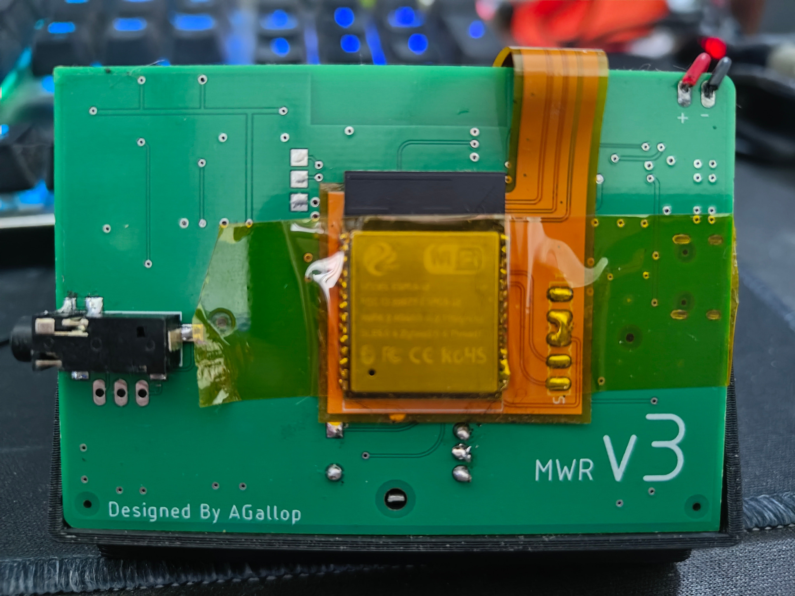
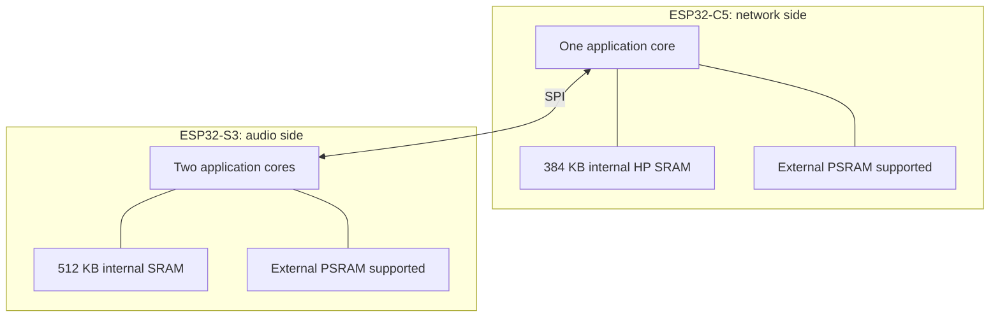
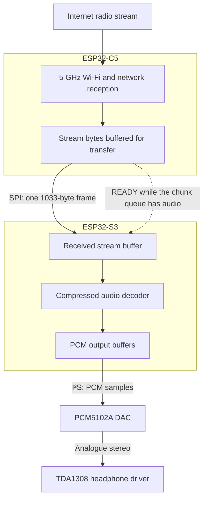
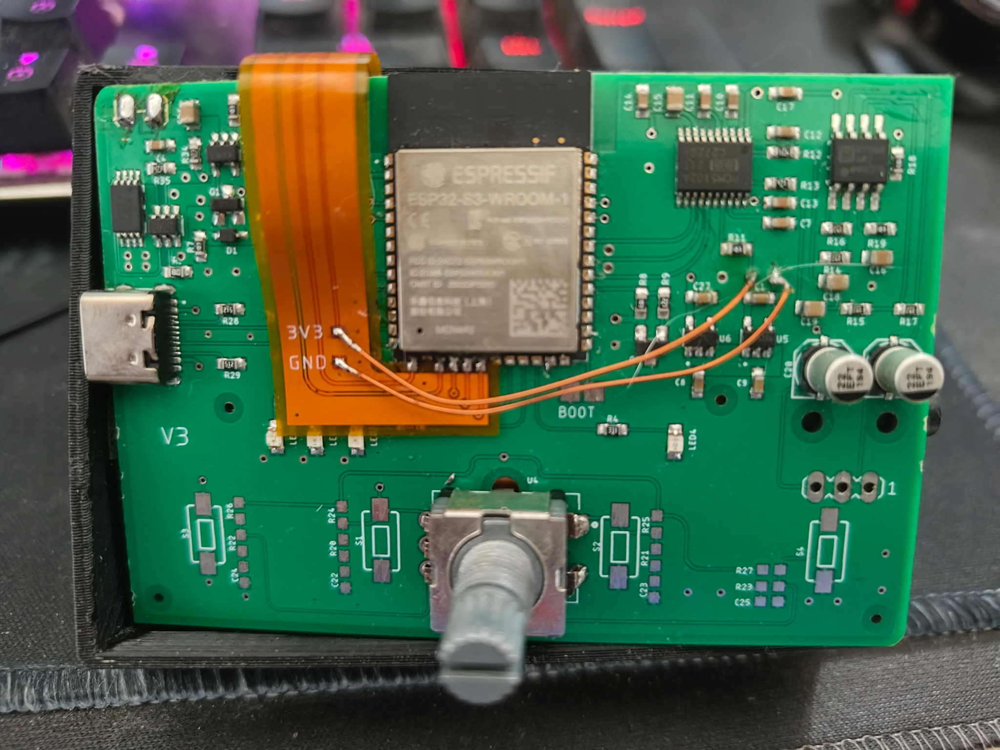
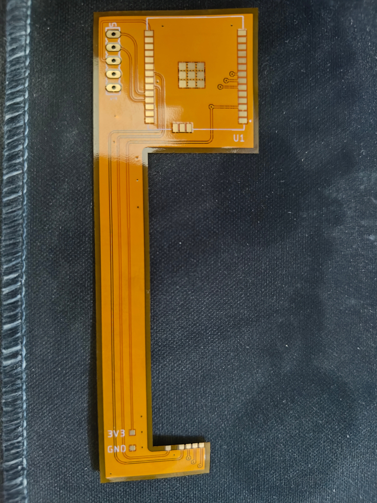
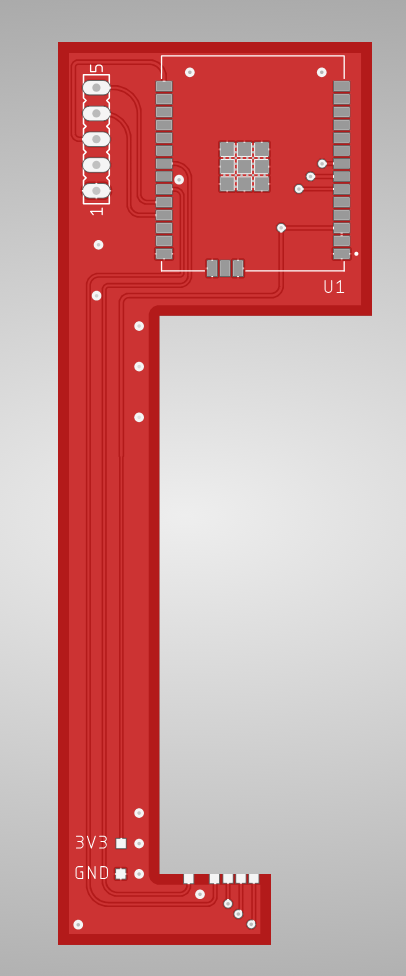
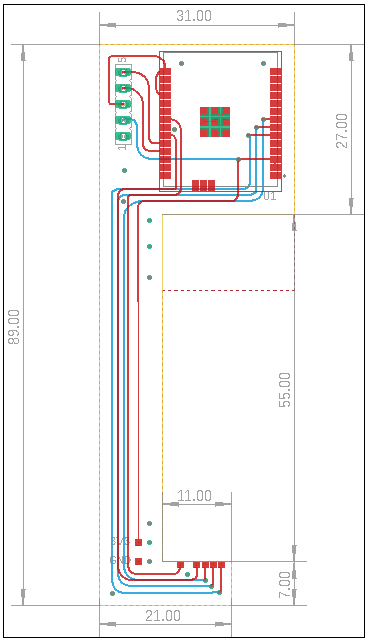

# Mini Web Radio 3 — 5 GHz Backpack

This project started when the hospital switched off its 2.4 GHz Wi-Fi. The Mini Web Radio was built around an ESP32-S3, which could no longer connect to the network. We also had 200 populated boards already fabricated, so replacing the main board was something I wanted to avoid.

The result is a backpack for [Mini Web Radio v3](https://github.com/AllanGallop/mini-web-radio-3). An ESP32-C5 handles the network connection, while the original S3 keeps doing the audio work. The main PCB, controls and audio hardware all stay in place.

  

## Keeping the S3

The S3 had already proved itself in the radio. It could decode the stream, feed the audio output and respond to the controls, with two processor cores and external RAM to help share the work. There was a working design and a working audio stack, so I wanted to keep as much of that as possible.

Unfortunately, its Wi-Fi hardware only supports 2.4 GHz and once that band disappeared from the hospital network, the radio needed another way to connect.

The ESP32-C5 offered the missing connectivity. The question was whether it should replace the S3 or work alongside it.

## Could the C5 do everything?

Replacing the S3 with a C5 would have made for a tidier design, but it would also have meant taking on a much larger software job.

The radio uses [a fork of ESP32-audioI2S](https://github.com/AllanGallop/ESP32-audioI2S), which is designed for multicore ESP32 devices. The C5 has only one app core. It does have a separate low-power processor, but it can't serve as the second application core the audio library expects.

Receiving a stream is only part of the job: the radio also has to buffer and decode it, keep the I²S output supplied, and respond when someone turns the dial. Moving everything onto the C5 would mean porting or replacing the audio stack and working out how to keep those jobs running reliably on one application core.

Memory is another constraint, although it is easy to overstate it. The C5 has less internal SRAM than the S3. Adding RAM can help with buffers; it doesn't make software written for two application cores work on one.

Keeping the S3 and giving the C5 responsibility for handling connectivity and fetching the stream was a more manageable change.

### Separate chips, separate memory

Using both processors doesn't give the radio a single shared pool of RAM. Each chip still has its own memory, and anything needed by the other has to be sent over SPI.

I did consider whether the two chips could share external PSRAM, but coordinating access would have added far too much complexity for this upgrade. Keeping their memory separate and passing the stream over SPI was a much more practical approach.

## Why not attach an SDIO radio?

Another option was to leave the S3 running the whole application and connect a 5 GHz Wi-Fi module over SDIO. That would have avoided changing where the stream was fetched, but getting it into the existing software environment was the sticking point.

The radio is built with PlatformIO and the Arduino framework. An SDIO module needs a host driver, support for the module's firmware, and a way into the networking APIs the application uses. Finding a module with a Linux driver wouldn't solve those problems for this build.

There are supported approaches, including [Espressif's ESP-Hosted](https://github.com/espressif/esp-hosted-mcu), which can connect a C5 over SDIO. Adopting one would still mean getting the host driver, Arduino core, underlying ESP-IDF version and audio dependencies working together.

There was also the question of how much work would remain on the S3. In the conventional hosted arrangement, the external chip handles Wi-Fi while TCP/IP and sockets remain on the host. The S3 would still be fetching the stream and handling HTTP, or TLS where required, alongside decoding and playback. Replacing the native Wi-Fi stack would remove some work too, and the only reliable answer would come from profiling the complete implementation. But it offered less separation of the networking and audio workloads than letting the C5 fetch the stream itself.

The choice of SPI wasn't what made the offload useful. The useful part was being able to hand the networking job to the C5 and give the S3 a stream of compressed audio bytes to play. There would still be two firmware builds and a protocol to maintain, but I could keep the interface focused on what this radio needed and make it easier for other builders to implement.

## Getting the two chips to cooperate

With the work split between the processors, the next problem was keeping audio moving between them. The C5 receives data in bursts from the network and the S3 has to turn it into a continuous audio output.

The backpack connects them over SPI, using `MOSI`, `MISO`, `CLK` and `CS`, with a separate `RDY` line for coordinating transfers. There is no wireless pairing between the chips: they are physically connected by a flex PCB.

The stream crosses that connection while it is still compressed. Decoding happens on the S3, and the resulting PCM samples go to the DAC over I²S.

Getting bytes across SPI is only the beginning. A faster clock moves a burst sooner, and it does nothing for a socket that has stopped. The two images have to agree on a fixed transfer, which of those bytes are audio, and what happens when a queue is full or a frame does not check out.

### Keeping the stream moving

An HTTP read, an SPI transfer and an MP3 frame are three different things. The C5 collects stream bytes and packages them for the link; the S3 puts the received audio into a ring buffer for the decoder. Those buffers give each processor some breathing room when the other is busy.

One detail that matters is what `READY` actually means. It tells the S3 that the C5 has queued audio, rather than telling the C5 that the S3 has space. If the S3's ring buffer fills up, the current implementation drops the incoming chunk. When the C5's own queue fills, its HTTP task waits instead, allowing the network connection to slow down.

That distinction is worth making explicit: there is buffering on both sides, but there isn't end-to-end flow control protecting the S3's ring buffer.

### Current limitations

The link checks frames for corruption and tracks sequence gaps, but it doesn't request retransmission of missing audio. A full S3 ring buffer causes a whole chunk to be dropped. Reconnecting the stream also doesn't clear the queued audio or insert a restart marker, so bytes from the previous connection can be followed by bytes from the new one. These are limitations of the current firmware rather than guarantees of seamless recovery.

Protocol details: frame layout, queues and recovery

### SPI frame layout

Both firmware images declare the same packed `Frame`: a 9-byte header followed by a 1024-byte payload. Every SPI transfer clocks all **1033 bytes**, even when only part of the payload contains audio. The `len` field identifies the valid audio bytes; the unused payload is zero-filled.

| Byte offset | Field | Size | Purpose |
| --- | --- | --- | --- |
| 0 | `m0` | 1 byte | Magic value `0xA5` |
| 1 | `m1` | 1 byte | Magic value `0x5A` |
| 2 | `type` | 1 byte | `0x01` for audio |
| 3 | `flags` | 1 byte | Bit 0: Wi-Fi connected; bit 1: C5 awake |
| 4–5 | `len` | 2 bytes | Valid audio length, up to 1024 bytes |
| 6 | `seq` | 1 byte | Rolling sequence number |
| 7–8 | CRC | 2 bytes | CRC-16-CCITT |
| 9–1032 | `payload` | 1024 bytes | `len` audio bytes followed by zero padding |

The header is little-endian. `m0` and `m1` are `0xA5` and `0x5A`. `type` is `0x01` for audio. `flags` has Wi-Fi connected in bit 0 and C5 awake in bit 1; this C5 image sets the awake bit on every frame. `len` is a `uint16`, clamped to 1024. `seq` is a free-running `uint8`. The CRC-16-CCITT, polynomial `0x1021`, init `0xFFFF`, covers `type` through `seq` and `payload[0..len)`. The magic bytes sit outside it. There is no shared header between the two PlatformIO projects. The structs match because both copies were written to match.

### Buffer ownership and transfer timing

The C5 chunk queue uses static RAM: 31 KiB of payload waiting to be packetised, plus a length field on each slot. The DMA heap is only the three slave buffers. The slave keeps all three transactions queued, including when the chunk queue is empty. Those idle frames go out with `len = 0`, a valid CRC, and a new `seq`. `READY` is high only while `q` is not empty. The S3 sleeps on that pin and clocks a frame only while it stays high. A zero-length frame writes nothing into the ring. Up to three of them can already be armed when audio shows up, so the first clocks after `READY` rises can be empty frames that were filled earlier. They cost a transaction. The pin lags the other way too: popping the last chunk drops `READY` before that frame has necessarily been clocked, so a filled frame can sit in the slave queue until the next rise. It is not dropped.

`READY` means the C5 has a chunk. It does not mean the S3 has room. If the 128 KiB ring cannot hold `len` bytes, the S3 drops the whole chunk and counts the drop. The C5 is not told. Backpressure toward the server happens on the C5 queue instead: a full `q` makes the HTTP task wait 2 ms and retry the same bytes, which stalls the socket rather than discarding them.

A bad magic, an unexpected type, or a bad CRC is discarded before the ring. A gap in `seq` is counted, and the frame is kept. Wi-Fi state is a flag at the moment `fill_frame` runs. The S3 uses it for the Wi-Fi LED. It does not flush the ring when the flag clears, when the socket drops, or when `seq` restarts after a C5 reboot. Audio already queued is still played. On a dead stream the C5 closes the socket, waits, and issues the HTTP GET again. Whatever is still in `q` is sent first, then the new body, with no resync marker between them.

Configuration follows the same division. The C5 now joins the Wi-Fi network and fetches the stream, so that is where the network credentials and stream address belong. Updating the original S3 settings alone won't configure the backpack.

## Fitting it to the existing board

The hardware had to fit around a radio that was already built. There was no spare footprint for another module, and replacing the main PCB would have defeated much of the point of making an upgrade.

A flexible PCB let me put the C5 on the back of the board and fold the connections around to the S3. It takes care of the signal routing, with separate wires for power and ground.

  

That leaves the DAC, headphone driver, controls and main PCB in place. The flex is an unusual shape when laid flat, but makes more sense once it is wrapped around the board.

  

  

Fitting the module was only part of it. The 3.3 V supply also has to support another Wi-Fi device, the signal connections need to remain reliable, and the antenna needs suitable clearance. Those constraints still apply even when the extra hardware fits neatly into the case.

## Hardware

The [hardware directory](hardware/) contains the Eagle board and schematic files, plus [Gerbers](hardware/gerber.zip).

Connect the backpack's **3V3** pad to the `ASO` LDO regulator's 3.3 V output, and **GND** to a suitable via in the main board's ground pour. Refer to the schematic and build photographs for placement.

  

## Firmware

Both boards need the backpack firmware built and uploaded. **This prototype does not include the previous configuration provisions.** The settings and stream formats available in the original v3 firmware should not be assumed to be supported here.

### Mini Web Radio v3 (S3)

1. Open `firmware/S3` in PlatformIO.
2. Build.
3. Upload to the S3.

### Backpack (C5)

1. Open `firmware/C5` in PlatformIO.
2. Edit `main.cpp`:
   * Set `WIFI_SSID` and `WIFI_PASS` for your Wi-Fi network.
   * Set `HOST`, `PORT` and `PATH` for your audio stream.
3. Build.
4. Upload to the C5.

## Where this leaves the radio

The backpack is a compromise, but it lets the existing radio connect to 5 GHz without replacing the board or starting again with the audio software. The cost is another processor and a communication link; the benefit is keeping the parts of the design that already work.

A future version could bring both jobs back onto one suitably supported chip. For now, the C5 gets the stream and the S3 plays it, which is what the radio needed to do in the first place.

## Technical references

- [Mini Web Radio v3 hardware and firmware](https://github.com/AllanGallop/mini-web-radio-3)
- [Audio-library fork used by v3, including its multicore requirement](https://github.com/AllanGallop/ESP32-audioI2S)
- [Espressif ESP-Hosted coprocessor networking](https://github.com/espressif/esp-hosted-mcu)
- [ESP-Hosted MCU guide, including the host networking stack](https://github.com/espressif/esp-hosted-mcu/blob/main/docs/getting-started-mcu.md)
- [Espressif ESP32-S3 overview](https://www.espressif.com/products/socs/esp32-s3)
- [Espressif ESP32-C5-WROOM-1 / WROOM-1U datasheet](https://documentation.espressif.com/esp32-c5-wroom-1_wroom-1u_datasheet_en.html)
